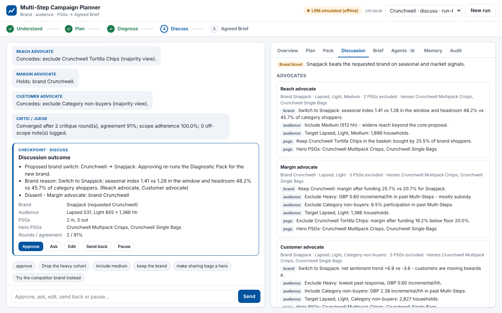

# multistep_agent

Multi-Step Campaign Planning Agent for Tesco campaign managers. A chat message starts a run.
Agents and the human then work through five checkpointed stages and finish with an
**Agreed Brief** (brand, audience, PSGs) for the external Recommendation Draft process.

- **Skills** (`campaign_agent/skills/*/SKILL.md`) tell each agent what to do. They become the
  agent's system prompt.
- **The harness** (`campaign_agent/harness/`) runs a skill as a ReAct loop on Tesco's LRM:
  - state- and memory-aware prompts;
  - tool dispatch;
  - output guards;
  - a deterministic fallback.
- **Tools** (`campaign_agent/tools/library/`) are the typed capabilities the agents call.
- **The LRM client** uses the same API setup as the PR coupon design agent: the EA Garage
  `v1/lrm/` endpoint, `X-API-Key`, and text-based `TOOL:`/`ARGS:` tool calling.
- **Orchestration** is LangGraph, with an interrupt after every stage, checkpointed state,
  and working plus episodic memory.

It runs on **seeded dummy data**: every brand, number and feed is fictional.

Design and code map: [docs/ARCHITECTURE.md](docs/ARCHITECTURE.md)

## Quick start

The UI and the CLI run **live on the Tesco LRM by default** (the same EA Garage `v1/lrm/` API as the PR coupon design agent). You need to be on the Tesco network or VPN.

1. Install the dependencies:

   ```bash
   pip install -r requirements.txt
   ```

2. Put your LRM credentials in a `.env` file in the project folder. It is git-ignored, so never commit real values. On Windows:

   ```bash
   copy .env.example .env
   ```

   On macOS / Linux:

   ```bash
   cp .env.example .env
   ```

   Then open `.env` and fill in `LRM_EMPLOYEE_ID` and `LRM_API_KEY`. Variables already set in your terminal take precedence over the file.

3. Check the live connection. It sends one tiny prompt and reports whether the credentials are found, whether the endpoint is reachable (VPN) and whether the key is accepted. Wait for `LIVE OK`:

   ```bash
   python -m campaign_agent.llm.check
   ```

4. Start the web UI and open http://127.0.0.1:8000. The header badge reads **LRM live**:

   ```bash
   python -m campaign_agent.web --lrm-mode live
   ```

   `--lrm-mode live` is the default, so `python -m campaign_agent.web` does the same. If the credentials are missing, it stops with instructions instead of quietly simulating. Each stage calls the LRM; a stage can take a minute or more, and the **Agent activity** card shows the agents working meanwhile.

Other entry points:

Start the terminal chat (also live by default):

```bash
python -m campaign_agent
```

Run an offline demo without the LRM (simulated model):

```bash
python -m campaign_agent.web --lrm-mode simulated
```

Run the scripted demo (always offline):

```bash
python -m campaign_agent.demo
```

Run the tests:

```bash
python -m pytest -q
```

Run the evaluation scorecard:

```bash
python -m campaign_agent.evaluation
```

The **simulated model** drives the real harness loop offline: prompts, tool calls, parsing, guards and memory. Its decisions equal the deterministic policies. If the live LRM is unreachable or returns unusable output for a step, that agent falls back to its rule-based policy and the run continues; the **Agents** tab shows which steps ran on the LRM and which fell back.

When the web UI starts, it prints which LRM mode it chose and why. Hover the badge in the header to see the same reason.

Use `--lrm-mode off` for fully deterministic agents. In the CLI, `/harness` shows which
skills ran on the LRM and which fell back (and why), and `/memory` shows working and
episodic memory.

## Web UI



A React front end (`campaign_agent/web/frontend`, Vite + TypeScript) served by a Flask API (`campaign_agent/web/app.py`).

- **Left, stage timeline:** the five stages with what each one decided so far (brand and objective, tools planned, checks passed, chosen brand, handoff), plus tool-call, send-back and agent-run counts.
- **Centre, conversation:**
  - A message starts a run. Each stage ends in a **"Your call"** card with the summary, key numbers and Approve / Ask / Edit / Send back / Pause, and suggested replies sit above the composer.
  - While agents work, a live **Agent activity** card streams what each one is doing: skills starting, tools called, guard rejections, fallbacks.
- **Right, inspector:**
  - **Evidence:** key numbers, agent findings, audience, PSGs and reconciliation.
  - **Plan**, **Debate** (outcome, dissent, advocates, critique rounds) and **Brief** (summary, handoff JSON, download).
  - **Agents** (LRM or fallback for every skill run), **Memory** (this run and past runs) and **Audit**.

Agent work runs in the background, so a stage that takes minutes on the live LRM never holds a request open. The browser follows progress over Server-Sent Events, and falls back to polling if a proxy blocks them.

The built bundle is committed in `campaign_agent/web/dist`, so running the UI needs Python only. You need Node only to change the UI:

```bash
cd campaign_agent/web/frontend
```

```bash
npm install
```

```bash
npm run dev
```

`npm run dev` hot-reloads on http://localhost:5173 and proxies the API to `python -m campaign_agent.web`, which must be running. When you're done, run `npm run build` to update `web/dist`.

The UI binds to `127.0.0.1` by default. Options:

- `--port 8000` sets the port.
- `--db runs/state.db` keeps runs across server restarts.
- `--lrm-mode auto|live|simulated|off` sets how agents run.
- `--autonomy L2` lets stages 1–3 advance on their own when confidence is high.

## Talking to it

| You say | It does |
|---|---|
| "yes" / "go" / "looks good" | approve, next stage |
| "What is SPC for light shoppers?" | answers from the pack or runs one more cut |
| "drop the heavy cohort", "yes, but lose the heavies", "make sharing bags a hero", "add sentiment_scan", "note: …" | edit |
| "try Snapjack instead", "send back to plan" | send back |
| "pause" | pause (with `--db runs/state.db`, resume later with `--run-id`) |

## Layout

```
campaign_agent/
  skills/             16 agent skills (SKILL.md) + HARNESS.md shared rules   <- what agents do
  harness/            ReAct runner, skill loader, state/memory context, schema + faithfulness guards
  llm/                Tesco LRM client (v1/lrm/, TOOL:/ARGS:), simulated + scripted transports
  agents/             roster + allow-lists, deterministic policies, harnessed.py (skill <-> harness bindings)
  tools/              28 tools (TOOL.md + manifest.yaml + golden tests), registry, MCP domain servers
  graph.py            LangGraph workflow: 5 stages, a checkpoint after each
  session.py, cli.py  chat session backend and terminal UI
  web/                Flask API (app.py, view.py) + React front end (frontend/ source, dist/ built bundle)
  memory.py           episodic memory; overrides re-weight scoring
  data/               seeded synthetic feature tables, live-API snapshots, Kantar cache, taxonomy
  guardrails.py, handoff.py, evaluation.py, mcp_server.py, demo.py
```
