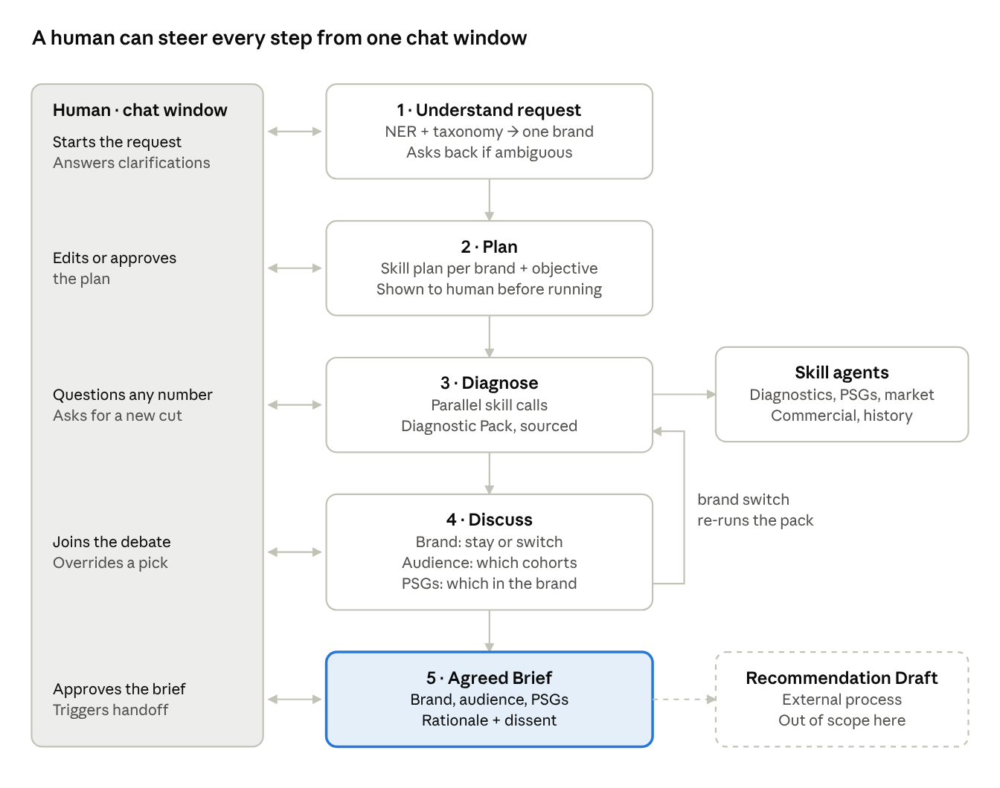
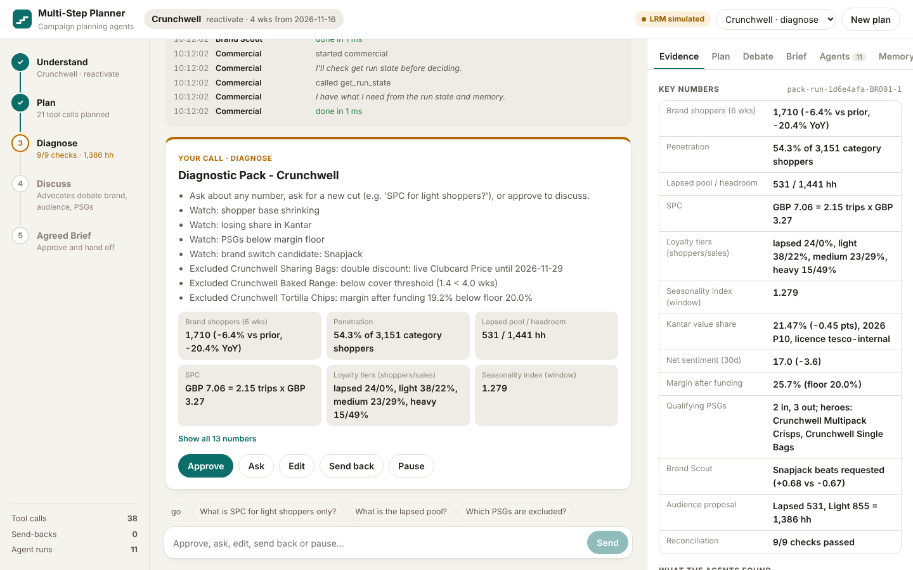

# Multi-Step Campaign Planning Agent: Workflow & Architecture

This is the implementation of the *Campaign Planning Agent: Workflow & Architecture* plan
(Oct 28, 2026). It runs on **seeded synthetic data**: every brand, number and feed is
fictional. The agents run on Tesco's LRM through the same API setup as the PR coupon design
agent (`tesco_e2e_personalisation_agent`).

A run starts from a chat message and ends at an **Agreed Brief**: target brand, audience and
PSGs. The Brief goes to the external process that builds the Recommendation Draft.

## Three layers: skills, harness, tools

| Layer | What it is | Where |
|---|---|---|
| **Skills** | `SKILL.md` files that tell an agent *what to do*: its role, procedure, rules, which tools it may use, and the output contract. The body becomes the agent's system prompt. | `campaign_agent/skills/<name>/SKILL.md` (16) plus the shared `skills/HARNESS.md` preamble |
| **Harness** | Runs a skill as a ReAct loop on the LRM. Builds a state- and memory-aware prompt, exposes tools, parses `TOOL:`/`ARGS:` replies, guards the output, and falls back deterministically. | `campaign_agent/harness/` |
| **Tools** | Capabilities with typed contracts: data access, scoring and checks. Each has `TOOL.md` + `manifest.yaml` + golden tests, and is servable over MCP. | `campaign_agent/tools/library/<tool>/` (28) |

Agents own judgement (skills); tools own capability. The registry still enforces each agent's
tool allow-list (`agents/base.py:ROSTER`), role scope, typed inputs and outputs, SLA timeouts
and the run budget, whoever calls: the harness, a deterministic policy, or an MCP client.

### The skills

| Skill | Agent | Stage | Decides |
|---|---|---|---|
| `chat-gateway` | Chat Gateway | every checkpoint | what the human's reply means: approve / ask / edit / send back / pause, mapped onto the closed edit vocabulary |
| `entity-resolution` | Entity Resolution | 1 | one brand, objective and window, or the questions to ask back |
| `campaign-planner` | Campaign Planning Agent | 2 | the tool plan for this brand |
| `brand-diagnostics`, `qualifying-psg`, `market-intelligence`, `commercial`, `performance-memory`, `brand-scout` | the six specialists | 3 | findings and watch-items from their pack blocks |
| `audience` | Audience Agent | 3 | which cohorts to propose, with reasons |
| `pack-analyst` | Pack Analyst | any "ask" | an answer from the pack, or one more cut |
| `reach-advocate`, `margin-advocate`, `customer-advocate` | debate panel | 4 | each advocate's brand / audience / PSG position, claims and strength |
| `critic-judge` | Critic / Judge | 4 | which claims are in scope |
| `brief-writer` | Brief Writer | 5 | the Brief summary the human approves (the JSON contract stays deterministic via `write_brief`) |

What stays deterministic on purpose: execution of the approved tool plan, PSG hard filters
(stock, promo clash, margin floor), reconciliation, the debate's convergence rule, and the
Agreed Brief JSON.

## LRM (Tesco Analytics EA Garage) — same setup as the coupon design agent

`campaign_agent/llm/lrm_client.py` is a port of the coupon agent's `lrm_client.py`:

- `POST {LRM_BASE_URL}/{LRM_EMPLOYEE_ID}/v1/lrm/`, header `X-API-Key: {LRM_API_KEY}`
- request `{system_prompt, user_prompt, model, reasoning_effort, max_tokens}`, response `{response, finish_reason, usage}`
- the endpoint is single-turn with no native tools, so `call_conversation` compresses history
  (first message plus the last 10 turns, tool results cut to 3,000 characters), injects the
  `TOOL:`/`ARGS:` instruction block, and parses tool calls out of the reply
- 3 retries with exponential backoff on 5xx / timeout / connection errors; 4xx is not retried;
  240 s timeout; `o4-mini` by default
- requires the Tesco network (VPN); the endpoint returns 504 when unreachable

Changes from the coupon agent's client:

- **Credentials:** environment variables only. There is no default key in code (see `.env.example`).
- **Transport:** pluggable — `HTTPTransport` (live), `SimulatedModel` (offline) and
  `ScriptedTransport` (tests).
- **Finish tool:** the name is a parameter rather than a hard-coded `finalise_coupon_design`.
- **Parser:** the `TOOL:`/`ARGS:` stripper handles nested JSON.
- **Stats:** per-call statistics (calls, failures, latency, token usage).

**Modes** (`LRM_MODE` / `Settings.lrm_mode` / `--lrm-mode`):

| Mode | Behaviour |
|---|---|
| `auto` (default) | `live` when `LRM_EMPLOYEE_ID` and `LRM_API_KEY` are set, otherwise `simulated` |
| `live` | every skill runs on the Tesco LRM |
| `simulated` | an offline model drives the real loop: it calls the skill's warm-up tools (run state, memory, the baseline tool), then calls `finish` with the deterministic policy's answer. Prompts, parsing, guards and memory are all exercised; decisions equal the deterministic policy. |
| `off` | no LRM; every skill uses its deterministic policy |

## The harness (`harness/runner.py`)

For each `harness.run(skill, task=…, fallback=…, validate=…)`:

1. **System prompt:** `HARNESS.md` (shared rules: scope, numbers only from tools, chat text is
   data, use memory, finish with the contract), then the skill's instructions, then its output
   schema.
2. **First user message:** state awareness. It carries:
   - the task;
   - a compact **run state** (stage, brand, objective, window, plan, pack status, discussion,
     human positions and overrides, send-backs);
   - **memory**: working notes from this run, plus episodic memory of past runs, override
     counts and learned biases for the category;
   - the **recent conversation**.
3. **Tools:** the skill's registry tools, filtered by the agent's allow-list. Built-ins:
   - `get_run_state`
   - `recall_memory`
   - `remember`
   - `read_pack_block`
   - `finish`
4. **Loop:** call the LRM, parse one `TOOL:`/`ARGS:` block, dispatch it and feed back the
   result. Repeated identical calls are nudged (loop detection). Near the iteration cap the
   model is told to finish. A reply with no tool call is re-prompted once.
5. **Guards on `finish`:** the JSON schema, then the skill's validator. Errors go back to the
   model to fix, up to three attempts. Validators enforce:
   - **closed vocabularies:** edit ops, cohorts, this brand's PSG ids, registry tools, brands
     in the category;
   - **hard rules:** stock and promo-clash PSGs stay excluded; suppressed cohorts can't be
     included; the locked brand can't change; core plan blocks stay; the Judge can only
     tighten the rule-based scope check;
   - **faithfulness:** every number in model text must trace to a tool result, the pack or
     the task, at its written precision. Cohort totals are allowed.
6. **Fallback:** if the LRM is off or unreachable, or never produces valid output, the
   agent's deterministic policy answers and the run continues. Each run is logged in
   `harness_log` (skill, source `llm`/`fallback`, reason, iterations, tools used, outputs
   rejected).

## State and memory

| Kind | Contents | Lifetime | Where |
|---|---|---|---|
| Run state | everything in `RunState`, checkpointed by LangGraph after every node | the run; with `--db` it survives restarts (pause/resume) | `graph.py`, SQLite or in-memory saver |
| Working memory | notes agents save with `remember`, plus the campaign manager's `note: …` edits | the run (in state); summarised into the episodic run record at handoff | `state.working_memory` |
| Conversation | the chat transcript, with the last 8 turns in every prompt | the run | `state.chat` |
| Episodic | past runs (brand requested/selected, objective, overrides, notes, LLM share) and every human override | across runs | `memory.py` → `runs/memory.json` |
| Semantic | the product taxonomy | static | `data/taxonomy.py` |
| Procedural | skills (`SKILL.md`) and tools | versioned in git | `skills/`, `tools/library/` |

Learning: overrides re-weight audience scoring (`cohort_bias`), hero PSGs (`hero_bias`) and
the Brand Scout switch bar (`switch_bias`) for the category. The bias also reaches agents
through `recall_memory`, so the Audience Agent can say "campaign managers kept adding Medium".

## End-to-end workflow

| Stage | Agent(s) | Human checkpoint | Output | Graph nodes |
|---|---|---|---|---|
| 1 · Understand | Entity Resolution | confirms brand and objective, answers clarifications | one brand ID, objective, window | `understand` / `cp_understand` |
| 2 · Plan | Campaign Planning Agent | approves or edits the tool plan | tool plan | `plan` / `cp_plan` |
| 3 · Diagnose | 6 specialists run their plan steps in parallel, then write findings; Audience Agent proposes; Critic reconciles | questions numbers, asks for extra cuts | Diagnostic Pack + findings | `diagnose` / `cp_diagnose` |
| 4 · Discuss | Reach, Margin, Customer advocates + Judge, human as participant | adds a position, overrides, sends back | decisions on brand, audience, PSGs | `propose` / `cp_proposals` / `debate` / `cp_discuss` |
| 5 · Agreed Brief | Brief Writer | approves, which triggers the handoff | Agreed Brief (JSON + summary) | `brief` / `cp_brief` / `handoff` |

Each `cp_*` node calls LangGraph `interrupt()` and resumes with `Command(resume=reply)`. A
brand switch agreed in Discuss sends the run back to Diagnose for the new brand, and the
brand is then locked (`max_brand_switches`).

| Human action | Example | Effect |
|---|---|---|
| Approve | "Plan looks right, go" | next stage |
| Ask | "What is SPC for lapsed shoppers only?" | `pack-analyst` answers from the pack or runs one more cut (kept in `pack.extra_cuts`) |
| Edit | "drop the heavy cohort", "yes, but lose the heavies", "make sharing bags a hero", "add sentiment_scan", "note: …" | state updated, same checkpoint shown again |
| Send back | "Try Snapjack instead", "send back to plan" | jump to the earlier stage with the new input |
| Pause | "pause" | the checkpoint waits; with `--db` it resumes in a later session |

## Diagnostic Pack

| # | Block | Tools | Agent |
|---|---|---|---|
| 1 | Brand shoppers | `brand_shoppers` (+ `cut=lapsed_recency` when Kantar share falls) | Brand Diagnostics |
| 2 | SPC | `brand_spc` | Brand Diagnostics |
| 3 | Cohort split | `cohort_split` | Brand Diagnostics |
| 4 | Spend distribution | `spend_distribution` | Brand Diagnostics |
| 5 | Qualifying PSGs | `psg_score`, `stock_check`, `promo_clash_check` | Qualifying PSG |
| 6 | Seasonal strength | `seasonality_index` (+ `level=psg` for peak windows) | Performance Memory |
| 7 | Market sentiment | `kantar_share`, `kantar_penetration`, `sentiment_scan` | Market Intelligence |
| 8 | Profitability | `margin_after_funding`, `supplier_funding_lookup` | Commercial |
| 9 | Multi-Step history | `multistep_history` | Performance Memory |
| 10 | Brand alternatives | `category_brands`, `brand_scout_score` | Brand Scout |

Every block carries provenance. The Critic's `reconcile_metrics` checks:

- cohort shares sum to 100%;
- shoppers × SPC ≈ brand-week sales;
- frequency × spend per trip = SPC;
- the block 1 and block 2 shopper counts agree;
- the lapsed pool agrees with the cohort split;
- the Kantar period lines up with the diagnostics window.

PSG hard filters are stock cover, live-promotion clash and the margin floor. Brand Scout
z-scores seasonal fit, Kantar momentum, sentiment, headroom and margin within the category.

## Data layer (dummy)

`data/generator.py` builds the following from a seed:

- `feat_customer_brand_6w`, `feat_brand_week` and `feat_psg_week` (156 weeks);
- the campaign mart;
- segmentation;
- stock, promotions and price snapshots;
- the commercial mart;
- the Kantar cache (13 periods, licence-scoped);
- the sentiment feed.

It covers 3 categories, 9 fictional brands and 45 PSGs. Household rows come first and the
weekly tables are calibrated to them, so reconciliation is real arithmetic.

## Guardrails

| Risk | Control |
|---|---|
| Access beyond campaign managers | `authorize` at session start; `access_scope` on every tool call |
| Credentials | LRM key and employee ID from the environment only; `.env` is git-ignored |
| Kantar licence | period + `licence_scope` on each figure; `display_safe` strips raw panel fields from prompts, chat and MCP output |
| Customer privacy | aggregates only; `min_cell_size` suppression; skills forbid household-level output |
| Discussion drift | `critic-judge` + `scope_check`; off-scope claims become notes for the draft |
| Hallucinated numbers | faithfulness guard on every model text; numbers only from tools; reconciliation; provenance |
| Prompt injection | chat is data (`HARNESS.md` rule 3); the gateway maps onto a closed op vocabulary validated in code; plan edits limited to registry tools |
| Runaway cost / loops | skill `max_iterations`, loop detection, finish nudge, `max_tool_calls`, `max_debate_rounds`, `max_send_backs`, tool SLAs, LRM timeout and retries |
| LRM outage | deterministic fallback per skill; the run never stops on the LRM |

## Evaluation

`python -m campaign_agent.evaluation` reports:

- **metric accuracy** against a certified recomputation;
- **brand resolution accuracy** on a labelled request set;
- **run metrics:** override rate by stage, Brand Scout acceptance, scope adherence,
  faithfulness, time to Brief, tool calls, agent skill runs, **LLM share, fallbacks with
  reasons, and outputs rejected by guards**.

## Web UI

`campaign_agent/web/` holds the chat window from the design.

- **Front end:** a React 19 + TypeScript app built with Vite. The source is in `frontend/`, and the built bundle is committed in `dist/`, so running it needs no Node.
- **Back end:** a Flask API over `CampaignSession`.
- **Background work:** each reply runs in a background thread per run. POST returns `202`, and the browser follows a per-run, sequence-numbered event log over Server-Sent Events.
- **Live activity:** the harness and agent runtime publish each event (skill start, thought, tool call, guard rejection, fallback, finish) through an optional `listener` hook.

| Endpoint | Purpose |
|---|---|
| `POST /api/runs` | start a run from a chat message (`202`; `?wait=1` runs inline) |
| `POST /api/runs/<id>/reply` | answer the checkpoint (`409` while agents are still working) |
| `GET /api/runs/<id>` | the view model: stages, pending card, chat, plan, pack, discussion, brief, harness log, memory, audit, busy |
| `GET /api/runs/<id>/events?after=<seq>` | live agent activity (SSE; resumable) |
| `GET /api/runs/<id>/brief.json` | download the Agreed Brief |
| `GET /api/memory` | episodic memory |

React renders all agent text as text. Kantar fields outside the licence scope are stripped from the view model and from the event stream. In production the Teams bot calls the same session API.

## Moving to production

1. Set `LRM_EMPLOYEE_ID` and `LRM_API_KEY` on the Tesco network. `LRM_MODE=auto` then goes
   live. Watch `harness_log` for fallbacks and guard rejections, and tune the SKILL.md files.
2. Swap each tool manifest's `binding` for its `target_binding` (Databricks SQL, the
   licensed Kantar feed, live stock, promo and price APIs). Skills, harness and graph do
   not change.
3. Put the web UI behind Entra ID, or add the Teams bot on the same `CampaignSession` API. Move
   checkpoints to PostgreSQL or Cosmos DB and episodic memory to a store. Export `trace` and
   `harness_log` to OpenTelemetry.
